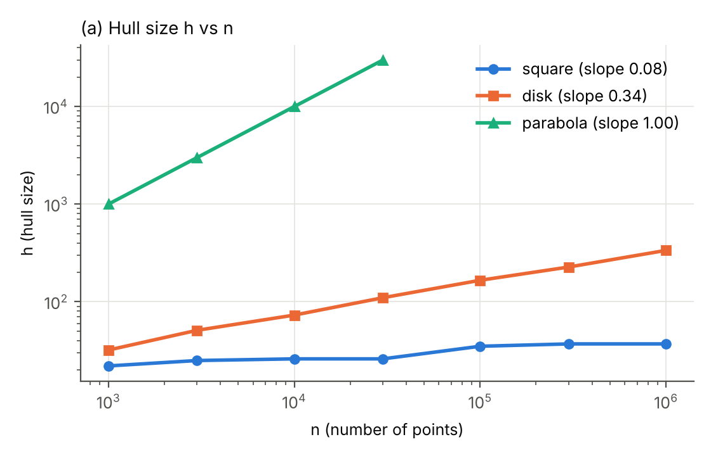
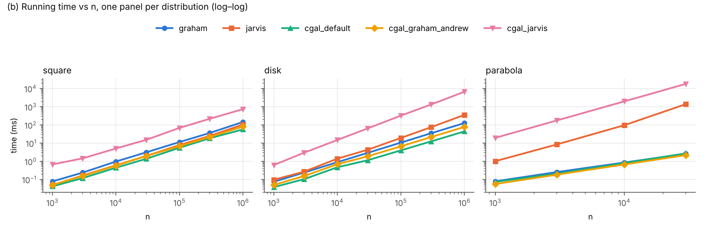

**Environment for every number in this report:** AMD Ryzen 5 5600X, Ubuntu under WSL 2 (Windows), GCC 15.2 (libstdc++), CGAL from the Ubuntu package, CMake Release build (`-O3 -DNDEBUG`). The Part 5(b) timings come from `calipers_check.cpp` on the same CPU.

All four test files give identical output with `graham`, `jarvis` and CGAL:

| Input | Output (h: vertices) |
|---|---|
| `example13.txt` | 5: (312,56) (684,86) (720,170) (420,308) (192,146) |
| `square_degenerate.txt` | 4: (0,0) (4,0) (4,4) (0,4) |
| `collinear.txt` | 2: (0,0) (3,3) |
| `single.txt` | 1: (7,−2) |

## Part 0 — Setup

**Q0. Why is a precise output convention essential for automatic comparison?**
On `example13.txt`, CGAL's `convex_hull_2` returned the same 5 vertices but started at (192,146), not at the lowest point (312,56). A program compares hulls as sequences, so two correct hulls written in different ways look different. The same polygon can be written in many ways: it can start at any of its h vertices, go clockwise or counter-clockwise, and include or leave out points that lie in the middle of an edge. Duplicates add even more versions. A tester that does not fix all of these choices would report false mismatches. It would also need its own geometric "same polygon" check, which could have bugs of its own. Fixing one *canonical form* (only extreme points, no duplicates, counter-clockwise, starting at the lowest-then-leftmost point, and fixed outputs for the degenerate cases) reduces the comparison to `H1 == H2`. That is exactly what `stress.cpp` does.

## Part 1 — Orientation test and Graham scan

**Q1.1. Can `orient` overflow?**
With |x|, |y| ≤ 10⁹:

- Each difference (e.g. `b.x − a.x`) satisfies |·| ≤ 2·10⁹.
- Each product satisfies |·| ≤ (2·10⁹)² = 4·10¹⁸.
- The result is the difference of two products, so |orient| ≤ 8·10¹⁸.

A signed 64-bit `long long` holds values up to 2⁶³ − 1 ≈ 9.22·10¹⁸. Since 8·10¹⁸ < 9.22·10¹⁸, no intermediate value and no result can overflow. The same bound covers `dist2` (≤ 2·4·10¹⁸).
If coordinates could reach 10¹⁰, the products could reach 4·10²⁰ and the result 8·10²⁰, which does not fit. In that case we would compute `orient` in `__int128` (range ≈ 1.7·10³⁸), or use an arbitrary-precision integer type such as GMP's `mpz_class`. We would keep exact integer arithmetic either way.

**Q1.2. Popped points on the class example; why the scan is O(n).**
Angular order around p0 = (312,56) (ties broken by distance):
(684,86) (636,104) (720,170) (612,152) (576,194) (492,218) (420,200) (378,146) (402,224) (420,308) (288,170) (192,146).

The scan pops 8 points, in this order (we confirmed it by instrumenting the code):

| # | popped | when this point arrives |
|---|---|---|
| 1 | (636,104) | (720,170) |
| 2 | (612,152) | (576,194) |
| 3 | (576,194) | (492,218) |
| 4 | (378,146) | (402,224) |
| 5 | (420,200) | (402,224) |
| 6 | (402,224) | (420,308) |
| 7 | (492,218) | (420,308) |
| 8 | (288,170) | (192,146) |

The stack ends with the 5 hull vertices (312,56), (684,86), (720,170), (420,308), (192,146).

The scan is O(n) by an amortized argument. Each point is pushed exactly once (n pushes), and a point can be popped at most once after it is pushed, so all the `while` loops together do at most n pops. Each orientation test either causes a pop or ends a `while` loop, and a loop ends once per pushed point. That gives at most 2n tests. A single `while` loop can pop many points, but the *total* number of pops is bounded. The O(n log n) cost of Graham scan therefore comes from the angular sort.

## Part 2 — Jarvis march

**Q2. Orientation tests on `example13.txt`; worst input.**
Our `jarvis` performs **60** orientation tests on `example13.txt` (n = 13, h = 5).
For each of the h hull vertices, the inner loop tests every one of the other n − 1 distinct points once. The total is **h·(n − 1)** = 5·12 = 60, i.e. Θ(nh). The benchmark matches this formula exactly; for example, square n = 10⁶, h = 37 gives 36,999,963 = 37·999,999 tests.
The slowest input is one where **every point is a hull vertex** (h = n), e.g. n points on a circle or on the parabola y = x². Jarvis then needs n(n − 1) = Θ(n²) tests. With n = 30,000 on the parabola we measured 899,970,000 tests and 1.4 s, while Graham scan took 2.6 ms.

## Part 3 — Stress testing against CGAL

We completed `stress.cpp`:

- `cgal_hull` now rotates CGAL's output with `std::rotate(H.begin(), std::min_element(H.begin(), H.end()), H.end())`. This uses our `operator<` (lowest, then leftmost), so CGAL's hull starts where ours does.
- The input type now depends on `seed % 4`: plain random points, inputs with duplicated points (every third point repeated, plus one extra copy of the first), inputs with the 5 collinear points (−1000 + 500k, −10⁹) for k = 0..4 on the bottom edge, or both. Each input is then shuffled so the extra points are not always at the end.

Result: **`OK: 0 mismatches`** on the 3000 inputs (1000 seeds × 3 distributions, n up to 300), in well under a second.

**Q3. Bugs found, the conversion to `double`, and the CGAL kernel.**

*Bugs.* The stress test found **no bugs** in our `graham` or `jarvis`:

- Both remove duplicates.
- Graham pops on `orient ≤ 0`, which drops collinear points.
- Jarvis keeps the farther point when candidates are collinear.
- Inputs with fewer than 3 distinct points are returned in sorted order.

The only failure was in the harness itself: before the rotation was added, nearly every input was a "mismatch" because CGAL starts the hull at a different vertex.

To check that the test can detect real errors, we injected a bug into a copy of Graham: we changed `orient ≤ 0` to `orient < 0`, so points in the middle of an edge are kept. The stress test reported **1500 mismatches**, all of them in the inputs with collinear points (seeds with `seed % 4` = 2 or 3). Random integer points are almost never collinear, so **without the collinear cases this bug would have passed**. That is why the extra cases are needed.

*Why converting to `double` is safe.* A `double` has a 53-bit significand, so every integer with |x| ≤ 2⁵³ ≈ 9·10¹⁵ is represented exactly. Our coordinates satisfy |x|, |y| ≤ 10⁹ < 2⁵³, so the conversion loses nothing. Converting back to `long long` is also exact, because `convex_hull_2` only *selects* input points and never creates new coordinates.

*Kernel.* We use `CGAL::Exact_predicates_inexact_constructions_kernel` (EPICK):

- **Exact predicates.** Every predicate, i.e. every function that returns a sign or a discrete answer (orientation, coordinate comparisons), always returns the mathematically correct answer. CGAL first evaluates the predicate quickly with interval arithmetic on doubles. If the interval contains 0 and the sign is therefore uncertain, it recomputes the predicate with exact multi-precision arithmetic (GMP).
- **Inexact constructions.** Operations that *create* new geometric objects (intersection points, midpoints, distances with square roots) are computed in plain `double` and may be rounded.

A convex hull uses only predicates, so CGAL's hull is exactly correct. That is what makes it a valid reference.

## Part 4 — Experiments: when does h matter?

`bench.cpp` times our `graham` and `jarvis` (and also reports Jarvis's number of tests), `CGAL::convex_hull_2`, `CGAL::ch_graham_andrew` and `CGAL::ch_jarvis`. Both Jarvis variants are skipped when n·h > 2·10⁹. The output is in `results.csv`. The hull sizes match the sanity check in the handout exactly: square h = 22, 26, 35, 37 and disk h = 32, 73, 166, 336 for n = 10³ … 10⁶.

{width=50%}

{width=92%}

Selected timings (ms; full data in `results.csv`):

| dist | n | h | graham | jarvis | cgal default | cgal graham_andrew | cgal jarvis |
|---|---:|---:|---:|---:|---:|---:|---:|
| square | 1,000 | 22 | 0.08 | 0.05 | 0.04 | 0.05 | 0.68 |
| square | 10,000 | 26 | 0.98 | 0.61 | 0.45 | 0.58 | 5.10 |
| square | 100,000 | 35 | 11.52 | 7.88 | 5.58 | 6.88 | 68.73 |
| square | 1,000,000 | 37 | 145.95 | 105.57 | 56.88 | 81.30 | 740.93 |
| disk | 1,000 | 32 | 0.08 | 0.10 | 0.04 | 0.05 | 0.63 |
| disk | 10,000 | 73 | 0.90 | 1.41 | 0.47 | 0.70 | 14.92 |
| disk | 100,000 | 166 | 10.71 | 19.35 | 4.03 | 6.70 | 325.79 |
| disk | 1,000,000 | 336 | 127.20 | 357.99 | 44.21 | 78.64 | 6,685.30 |
| parabola | 1,000 | 1,000 | 0.08 | 1.03 | 0.08 | 0.06 | 19.58 |
| parabola | 10,000 | 10,000 | 0.86 | 96.84 | 0.81 | 0.68 | 1,983.58 |
| parabola | 30,000 | 30,000 | 2.63 | 1,397.67 | 2.74 | 2.20 | 18,153.90 |

**(a) Slope for the disk.** A least-squares fit of log h against log n on plot (a) gives a slope of **0.34** for the disk. This agrees with h = Θ(n^1/3^) (slope 1/3 ≈ 0.333). The absolute values also match the asymptotic constant for a disk, E[h] ≈ 3.38·n^1/3^ (Rényi–Sulanke), which predicts h ≈ 338 for n = 10⁶; we measured 336.
For comparison, the square has slope 0.08. That is the near-flat shape of a logarithm, and h ≈ (8/3)·ln n predicts 36.8 for n = 10⁶, against 37 measured. The parabola has slope 1.00 (h = n).

**(b) Where Jarvis is competitive.** On the **square**, our Jarvis march is faster than our Graham scan at every n: it takes 63–72% of Graham's time, e.g. 106 vs 146 ms at n = 10⁶. Jarvis costs O(nh) and Graham O(n log n), so Jarvis wins when h is comparable to or smaller than log n, as it is in the square (h ≈ 37 vs log₂ n ≈ 20). With such similar operation counts, the constant factor decides. Jarvis makes h linear, cache-friendly passes of cheap integer `orient` calls, while Graham pays for a sort whose comparator calls `orient` and is hard to predict.
On the **disk**, Jarvis is closest at small n: only 1.3× slower than Graham at n = 1000 (0.10 vs 0.08 ms), when h = 32 is still comparable to log₂ n ≈ 10. Beyond that, h ∝ n^1/3^ grows much faster than log n and Jarvis falls further behind: 2.8× slower than Graham at n = 10⁶.
On the **parabola** (h = n), Jarvis is hopeless: about 530× slower than Graham at n = 30,000.

**(c) Jarvis on the parabola when n × 10.** From n = 1,000 to n = 10,000, the time grows from 1.03 ms to 96.8 ms (**×94**) and the number of tests from 999,000 to 99,990,000 (×100). The theory predicts Θ(nh) = Θ(n²), i.e. ×100 when n is multiplied by 10, which matches: a slope of ≈ 2 on the log–log plot. From n = 10,000 to 30,000 the time grows ×14.4, more than the predicted ×9. This comes from memory effects: once the point array no longer fits in the fast caches, each of the h passes over the n points costs more.

**(d) Why Akl–Toussaint helps on the square and the disk, but not on the parabola.**
The heuristic finds the 4 extreme points in x and y in O(n) and discards every point inside the quadrilateral they form. Those points cannot be hull vertices.

- In the **square** and the **disk**, the extreme points lie near the boundary, so the quadrilateral covers a large fraction of the region. For a disk, the quadrilateral is close to the inscribed square, with area 2r² out of πr² ≈ 64% of the disk. Most points are discarded in a single cheap pass, and the expensive part of the algorithm runs only on a small remainder in the 4 corner regions. We measured CGAL's default as 1.4× faster than its own Graham–Andrew on the square (57 vs 81 ms at n = 10⁶) and 1.8× faster on the disk (44 vs 79 ms).
- On the **parabola**, every point is a hull vertex. The parabola is convex, so the points between the leftmost and the lowest point lie *below* the chord that joins them, outside the quadrilateral. Nothing can be discarded, and the filtering pass is pure overhead: on the parabola, CGAL's default is slightly *slower* than Graham–Andrew at every n (2.74 vs 2.20 ms at n = 30,000).

## Part 5 — Application: fencing an orchard

`app.cpp` computes `perimeter`, exact `twice_area` (shoelace formula in `long long`) and `diameter2` with rotating calipers in O(h). Output on `example13.txt`, identical to the expected one:

```
h = 5
perimeter = 1224.508
area = 80316.000
diameter = 528.545  between (720, 170) and (192, 146)
```

*Why the shortest fence is exactly the hull.* Any closed fence that encloses all the trees also encloses their convex hull, because the region inside the fence contains the points and we can take it to be convex. Among closed curves that enclose a convex set, the boundary of that set is the shortest: the nearest-point projection onto a convex set never increases length, so projecting any enclosing curve onto the hull gives a curve that is no longer and that traces the hull boundary.

**(a) Why the farthest pair is always two hull vertices.** Fix a point p. The function q ↦ |p − q| is convex. The maximum of a convex function over a convex polygon is attained at a vertex, because every point of the polygon is a convex combination of the vertices. So for any pair (p, q), we can replace q by a hull vertex without decreasing the distance. Applying the same argument to p gives a farthest pair made of two hull vertices. This is why it is enough to search the h hull vertices instead of all n points.

**(b) Validation and running time.** Using `calipers_check.cpp`, we compared `diameter2` against an O(n²) brute force over all pairs of input points. On 1500 random inputs (square, disk and parabola, n ≤ 400, half of them with the 5 collinear bottom-edge points), the two methods gave **0 mismatches**, both in the squared distance and in the returned pair.
For n = 10⁵ points in a square (h = 35):

| step | time |
|---|---|
| Graham scan | 12.8 ms |
| rotating calipers on the hull | 0.0006 ms |
| brute force O(n²) on all points | 4,276 ms |

The whole pipeline is O(n log n) + O(h) = **O(n log n)**: hull plus calipers, dominated by the sort in Graham scan. It is about 330× faster than the brute force at n = 10⁵, and the gap grows linearly with n.

**(c) Can `twice_area` overflow? How would we fix it?**
Each term x~i~y~i+1~ − x~i+1~y~i~ is the difference of two products of absolute value ≤ 10¹⁸, so it fits (≤ 2·10¹⁸). The final value is twice the hull area. The hull lies inside the box [−10⁹, 10⁹]², whose area is 4·10¹⁸, so 2A ≤ 8·10¹⁸ < 9.22·10¹⁸. We checked the extreme case, the 4 corners of the box, which gives exactly 8·10¹⁸. The final result always fits, but with almost no margin, and this bound does not cover the *intermediate partial sums* of the loop. Those partial sums can be larger than the final result, and signed overflow in C++ is undefined behaviour, even if the final value would "wrap back".
Fixes:

1. Accumulate in `__int128` and convert at the end. This is the simplest fix.
2. Measure coordinates relative to H[0]. For a convex polygon in counter-clockwise order, each term is then twice the area of the triangle (H~0~, H~i~, H~i+1~), which is ≥ 0. The partial sums only grow and never exceed the final 2A ≤ 8·10¹⁸.

With coordinates up to 10¹⁰, even the final value would not fit, and `__int128` would be required.

## Part 6 — Robustness: why exact predicates?

`./robust` evaluates the orientation of p = (0.5 + i·u, 0.5 + j·u), q = (12, 12), r = (24, 24), with u = 2⁻⁵³ and 0 ≤ i, j < 256. It computes each sign once with plain `double` arithmetic and once with CGAL's exact predicate.

**Q6.** On our machine, **11,972 of the 65,536 naive `double` orientations (18.3%) had the wrong sign.**

*Where the error comes from.* q and r lie on the line y = x, and (0.5, 0.5) lies on it too, so every p is almost collinear with q and r. The true orientation is a tiny number, about (j − i)·u·12. The coordinates of p are exact, because near 0.5 the spacing between doubles is exactly 2⁻⁵³. But a difference such as 12 − p~x~ ≈ 11.5 falls in [8, 16), where the spacing is 2⁻⁴⁹. That result is rounded, and the low-order bits that distinguish neighbouring values of i and j are lost. The formula then subtracts two nearly equal products (*catastrophic cancellation*). The rounding errors of the products are as large as, or larger than, the true value, so the computed sign follows the rounding pattern rather than the geometry.

*What would happen to Graham scan.* A comparator built on this predicate is inconsistent: it can say a < b, b < c and c < a, or give different answers for the same points depending on how they are passed. That breaks the *strict weak ordering* that `std::sort` requires, and violating it is undefined behaviour. In the mildest case the points are sorted incorrectly, and the stack scan then outputs a polygon that is not convex, misses extreme points, or keeps interior ones. In worse cases, libstdc++'s introsort uses unguarded insertion loops that trust the comparator, so it can read past the end of the array and crash. The scan itself also uses the same predicate to decide pops, so the errors compound.

*Why our integer `orient` does not have this problem.* Our coordinates are integers, and as shown in Q1.1, every subtraction, product and the final result fit in a 64-bit `long long` when |x|, |y| ≤ 10⁹. Integer arithmetic within range is exact: nothing is rounded, so the computed sign is always the true sign and the comparator is always consistent. CGAL reaches the same guarantee with floating-point input by filtering and falling back to exact arithmetic, which is why `robust` can use it as the ground truth.
